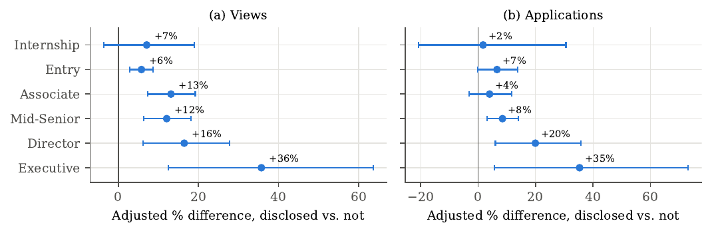

# Salary Disclosure and Job-Posting Engagement Across Career Levels

Do LinkedIn job postings that **disclose salary** get more engagement (views and applications), and does that association **differ by career level**?

DS 502 / MA 543 *Statistical Methods for Machine Learning*, Worcester Polytechnic Institute, Fall 2026: Group 4 final project (progress report stage).

**Team:** Aditya Jambhale · Vansh Patel · Syeda Tamzida Akter

📄 **[Read the progress report (PDF)](report/progress_report.pdf)**

---

## Key findings (so far)

- **Data:** 123,849 postings from the Kaggle *LinkedIn Job Postings (2023–2024)* dataset; 29% disclose salary.
- After controlling for work type, remote status, application type, posting age, description length, region and industry, postings that disclose salary get about **10% more views** and **8% more applications**.
- **The association grows with seniority** for views: about +6% at entry level and +36% at executive level (joint test of the interaction terms, p = 0.005). Applications show a similar pattern, but it is not statistically significant (p = 0.19).
- Ridge and Lasso do not improve out-of-sample error (5-fold CV R² ≈ 0.15–0.17). Lasso is used mainly as a variable-selection check on the interaction terms.



## Methods

- Outcomes modeled as log(1 + views) and log(1 + applications), because both are extremely right-skewed
- Three nested OLS models: disclosure only → + career level and controls → + disclosure × career-level interaction
- Standard errors **clustered by company**; joint Wald test of the interaction terms
- 5-fold cross-validation comparing a mean baseline, OLS, Ridge and Lasso
- Sensitivity checks: postings with an unspecified level kept as their own category; annual-salary disclosures only

## Repository structure

```
code/analysis.py          Full analysis: cleaning, feature engineering, OLS, Ridge/Lasso, CV, figures
results/results.json      Every number reported in the paper, written by analysis.py
report/main.tex           LaTeX source of the progress report
report/progress_report.pdf
report/figures/           Figures 1–4
```

## Reproducing the results

1. Download the [LinkedIn Job Postings (2023–2024)](https://www.kaggle.com/datasets/arshkon/linkedin-job-postings) dataset from Kaggle and unzip it into `data/`, so that you have:
   ```
   data/postings.csv
   data/jobs/job_industries.csv
   data/mappings/industries.csv
   ```
2. Install the requirements and run the analysis:
   ```bash
   pip install -r requirements.txt
   python code/analysis.py data output
   ```
   This writes `output/results.json` and `output/figures/`.

The dataset is not included in this repository.
